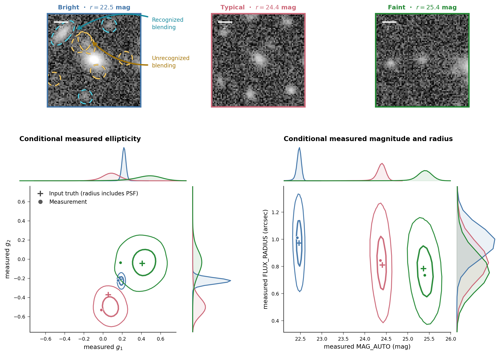

# Simulation-Based Shear Inference



**v3.9-like** flow predictions for three simulated galaxies. In the first stamp,
dashed ellipses and curved-arrow labels mark recognized (cyan) and unrecognized
(gold) neighbours. Input-truth radius
markers include the PSF and pixel response; ellipticity truth corresponds to
the PSF-corrected shape measurements. [Figure conventions and reproduction](doc/README_FIGURE.md#figure-conventions).

SBSI provides model loading and prediction, finite-scene likelihoods,
selection normalization, importance sampling, and Bayesian shear inference.
BlendEMU owns image simulation, measurement, catalogue production, and
response-emulator training.

## Model and numerical identities

| Role | Identity | Status |
| --- | --- | --- |
| Retained development model | `V3.9-like` | F8 flow, C8 classifier, physical-moment disk emulator |
| Historical development model | `V3.6-like` | original common-descent flow and17-input classifier |
| Historical model preset | `V3.5-like` | epoch154, trial9, three-classifier ensemble |
| Default likelihood | `v3.2-like` | `configs/likelihood.json` |
| Default estimator | `v1.1-infer` | `configs/inference.json` |
| Tilted-stratified estimator | `v1.2-infer` | `configs/inference_v1_2.json` |

V3.9-like uses the same eight raw target/crowding inputs for its flow and
classifier. Its constant-shear development bias is **+0.021% ±0.265 percentage
points**, with measured radius>0.6 arcsec and magnitude<25.8 independently in
each shear leg, without truth-property cuts. The classifier replicate gives
+0.062% ±0.265 percentage points. These reused development results do not
establish robust 0.3% calibration; classifier probability losses worsened.

The owner wrapped up the investigation on 2026-09-25. The exact artifacts,
feature contract, original evidence and limitations are recorded in
[the V3.9-like model guide](doc/V39_MODEL.md#decision-and-identity) and
[manifest](configs/models_v3_9_like.json).

## Inspect models

Set `SBSI_CACHE_DIR` to the external SBSI cache root and `BLENDEMU_RUNS_DIR`
to the external BlendEMU runs root, then:

```bash
python -m sbsi show-model V3.9-like
python -m sbsi validate-model V3.9-like
```

`get_model("V3.9-like")` returns pinned paths. This names a model set, not a
likelihood or numerical release. The default additive workflow is unchanged;
the dedicated V3.6 disk driver cannot reuse its old feature stores for V3.9.
See [loading and inference scope](doc/V39_MODEL.md#loading-and-inference-boundary).

## Run inference

```bash
python scripts/run_inference.py \
  --inference-config configs/inference.json \
  --likelihood-config configs/likelihood.json \
  --scene-store /path/to/scene \
  --measurement-model /path/to/configured-flow.pt \
  --blend-response-cache /path/to/rblend-cache \
  --model-cache /path/to/model-cache \
  --proposal-cache /path/to/proposal-cache \
  --output /new/output/path
```

Inputs and model/cache identities must match the selected likelihood config.
See [the inference workflow](doc/INFERENCE.md#active-workflow).

## Repository

- `sbsi/`: supported model, likelihood, and inference modules.
- `scripts/`: scene preparation, cache construction, inference, and reporting.
- `jobs/`: reusable inference/cache launchers and the CPU test launcher.
- `tests/`: core regression tests, model loading, and retained feature contracts.
- `configs/`: numerical/likelihood configurations and model manifests.
- `doc/`: current documentation; start with [the repository map](doc/REPOSITORY.md#active-layout).
- `archive/`: dated, hash-indexed research snapshots; excluded from imports and tests.

## Installation and tests

```bash
python -m pip install -e /path/to/SBSI
python -m pytest tests -q
```

Install BlendEMU in the same environment for the historical additive emulator.
The disk-response loader also requires XGBoost. Heavy work and full
test runs use the scheduler; see [environment and resources](doc/ENVIRONMENT.md#tests).

## Documentation

- [API and scope](doc/API.md#scope-boundary)
- [Inference](doc/INFERENCE.md#current-identities)
- [Finite catalogue prior](doc/CATALOGUE_PRIOR.md)
- [Mathematical derivation](doc/MATH.md)
- [Scientific conventions](doc/CONVENTIONS.md)
- [V3.9-like evidence](doc/V39_MODEL.md#development-evidence)
- [Historical V3.6-like evidence](doc/JOINT_CALIBRATION.md#retained-evidence)
- [Change log](doc/WORKLOG.md)
