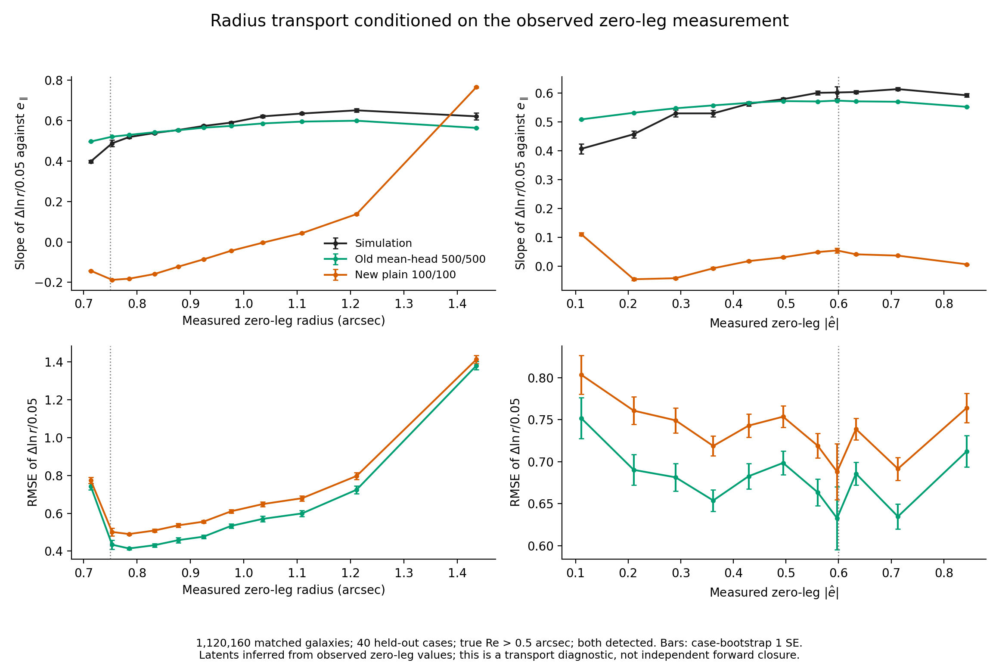

# Minimal paired-transport trial toward 0.3% closure

## Objective and scope

The owner's 2026-09-05 objective is |m|<=0.3%, with no empirical correction
and a minimal change. The working endpoint is complete ConstGold R11 with
the established measured cuts and true Re>0.37 support. Report m using
[the project convention](CONVENTIONS.md#8-m-and-its-relatives--one-sign-convention),
including case uncertainty and the training-seed limitation. The goal has
not yet been achieved. A diagnostic intervention is not a replacement model.

## Component localization and draw convergence

Building on [the initial localization](FLOW_SELECTION_LOCALIZATION.md#mean-preserving-transport-test),
array 16325083 uses the same ten shared-Re>0.5 cases and varies only which
output residuals are frozen between legs. All per-object means remain fixed.

| Frozen residual channels | All-cut m, 64 draws | All-cut m, 256 draws |
|---|---:|---:|
| None | +9.124% | +9.045% |
| Log radius | +4.821% | +4.794% |
| Magnitude and log radius | +4.912% | +4.884% |
| Shape e1/e2 | +5.464% | +5.404% |
| Shape and log radius | +1.404% | +1.401% |
| All four | +1.490% | +1.486% |

Case-bootstrap SE is about 0.73--0.78 percentage points for these totals.
Increasing the draw count does not remove the remaining bias, nor reduce
the simulation case uncertainty enough to establish 0.3% closure. Radius-only
m with only its residual frozen is +0.050%/+0.051%, but all-cut failure
requires addressing both shape and radius behavior. Magnitude contributes
relatively little in this test. No channel combination is deployed.

Artifacts: external `plain_complete_flow_response_re037_v1/localize_old_new_v1/`
`component_transport_v1/{diagnose.py,run.sh,summarize.py,new100_d*_cuts.json}`.

## Direct held-out paired audit

`sbsi/flow_transport.py` implements the latent coupling

    z = F_inverse(y_zero, context_zero)
    predicted_y_sheared = F(z, context_sheared)

for plain affine and non-RA mean-head flows, including the mean-head shift
in both directions. Measurements are standardized with the checkpoint's
existing transforms. `scripts/audit_flow_paired_transport.py` initializes
with observed zero-leg measurements and compares with the matched sheared
measurements. This diagnoses conditional transport; it is not independent
forward closure and must not be reported as such.

Job 16325114 audited all 1,120,160 matched shared-Re>0.5 validation pairs.
The 40 validation cases are disjoint from the 160 training cases. It drops
and reports 46,189 unmatched zero-leg rows, 43,131 unmatched sheared-leg
rows, population/detection/finite-target exclusions, and one zero-shear pair.
Model and simulation both use the actual forward 0->0.05 stencil.

Log-radius response RMSE is **0.685790 old**, **0.744454 new**, versus
**0.707785** if every change is predicted to be zero. Median absolute
log-radius response error is **0.128461 old** and **0.308393 new**. This
supports investigating supervision of the measured-state-dependent change.
The response has substantial outliers; none is clipped or removed to improve
agreement. Shape-response RMSE is approximately 2.56/2.59 in both models.
Inverse/forward identity errors remain small: maximum standardized error
2.15e-5 old and 1.24e-5 new.

A separate audit (16325236) checked the possible invalid-shape convention
mismatch before training: among all 1,708,854 matched Re>0.37 validation
pairs there are **zero** e1=-1 sentinels, **zero** both-zero shapes, and
**zero** |e|>=1 values in either leg. This hypothesis does not explain the
observed discrepancy. It does not certify unmatched or training rows.

External artifacts are in `plain_complete_flow_response_re037_v1/`
`paired_transport_audit_v1/`, including results, the sentinel-check script,
and `invalid_measurements.json`.

### Radius transport at the measured selection boundary

CPU job **16325784** profiles the existing old/new paired predictions by
zero-leg measured radius and measured ellipticity. It uses all 1,120,160
shared-Re>0.5 held-out pairs and 2,000 whole-case bootstrap resamples. The
orientation coefficient is an intercept-fitted slope of Delta ln(radius)/0.05
against intrinsic e_parallel, using the actual forward shear direction.

For **164,210** galaxies with zero-leg measured radius in **[0.70,0.80) arcsec**:

| Quantity | Simulation | Old mean-head 500/500 | New plain 100/100 |
|---|---:|---:|---:|
| Orientation coefficient | 0.498731 | 0.521645 | -0.178211 |
| Coefficient minus simulation, paired case SE | -- | +0.022914 +/- 0.003294 | -0.676942 +/- 0.003793 |
| Per-object response RMSE | -- | 0.431119 | 0.500324 |
| Median absolute response error | -- | 0.102951 | 0.263987 |

The new model has the wrong sign near the 0.75-arcsec selection boundary.
The profile shows a large discrepancy across much of the measured-radius
range, so this is not confined to a few extreme measurements. The old
transport is much closer there, although its coefficient residual is still
statistically resolved. This directly localizes a conditional transport
difference hidden by comparing unconditional per-object mean responses.
It is not evidence that the latent map is physically unique, nor a substitute
for independent forward selected-response closure.

Artifacts: `paired_transport_audit_v1/{plot_boundary.py,boundary_profiles.csv,boundary_profiles.json}`;
source parquet hash and the exact bootstrap definition are retained. The
PNG and PDF in `figures/flow_selection_localization_v1/` were inspected for
readability. No model or response correction was fitted.

Dependent CPU jobs **16325800** (weight 1) and **16325801** (weight 0.01)
will overlay each candidate after its per-output paired audit succeeds.
`paired_transport_audit_v1/compare_boundary.py` joins by case/input ID,
reports and rejects any unmatched rows, and requires exact equality of
measured response, zero-leg radius/ellipticity, and intrinsic orientation.
Each candidate's `boundary_comparison/` will retain source hashes, CSV/JSON,
and PNG/PDF. Python compilation and both wrapper syntax checks pass;
execution awaits the candidate artifacts.

### Direct radius-crossing diagnostic

CPU job **16325915** reconstructs each zero/sheared radius from the saved
paired responses and applies the fixed **radius>=0.75 arcsec** cut. It freezes
intrinsic e_parallel and evaluates the normalized selected-mean change divided
by 0.05. This isolates a direction-projected radius-selection term on the
same both-detected Re>0.5 validation sample; it is not ConstGold R11 or m.

The simulation has 8,099 entries and 7,678 exits. Its projected selection
response is **+0.055418**. The old model gives **+0.058794** (paired residual
**+0.003376 +/- 0.000731**), while the new model gives **-0.021302**
(**-0.076720 +/- 0.000932**). Errors use 10,000 whole-case bootstrap draws.
Thus the wrong conditional radius-transport sign also reverses this explicit
selection effect. Exact individual crossing recall is only **37.02% old**
and **7.28% new**: approximate agreement in an aggregate weighted response
does not mean that every individual noisy transition is predicted correctly.

External `paired_transport_audit_v1/{audit_crossings.py,radius_crossings.json}`
retain source provenance, full transition confusion matrices, and definitions.
Both pending candidate boundary comparisons now include this selection term
using their existing 2,000 case resamples. No output correction is learned.

The exact-radius update below supersedes the reconstructed simulation crossing
counts and their last decimals; the transport sign conclusion is unchanged.

### Completed weight-1 audits and exact reference masks

The full training/audit job **16325249** completed successfully in 1:47:33.
Independent matched-population NLL is **0.772416**, versus **0.119628** for
the parent under the same audit protocol. Global central shape responses are
**0.814314/0.812832** (parent **0.812215/0.812617**). Domain audit **16325250**
passes all 100 ConstGold cases and the established Re>0.37 support. The full
forward evaluation **16325251_0** is now running.

Paired audit **16325663** on the exact shared-Re>0.5 population reports
log-radius response RMSE **0.720661** (parent **0.744454**, old **0.685790**).
Near [0.70,0.80) arcsec, its orientation coefficient is **+0.099556** versus
simulation **+0.498731** and parent **-0.178211**. The sign improves but the
remaining coefficient residual is **-0.399174 +/- 0.004252**.

Initial boundary comparison **16325800** exposed a few threshold ties that
changed membership when raw radii were reconstructed from saved responses.
CPU job **16326156** now retains the original catalogue log-radius in pixels
and the actual per-row shear norm in `exact_radius_reference.parquet`.
Reference masks directly apply **log(radius_pixels)>=log(3.75)**, and model
predictions undo their saved response normalization using the actual norm.
No threshold offset or tolerance is introduced. Full reference/candidate
identity and measurement checks pass.

Corrected comparison **16326184**, in `paired_transport_train_v1/boundary_comparison_exact/`,
gives the frozen-intrinsic projected radius-selection response:

| Series | Response | Paired residual, case SE |
|---|---:|---:|
| Simulation | +0.055408 | -- |
| Old mean-head | +0.058794 | +0.003387 +/- 0.000727 |
| Parent plain | -0.021302 | -0.076709 +/- 0.000940 |
| Paired weight 1 | +0.010002 | -0.045405 +/- 0.000764 |

The original catalogue gives 8,103 entries and 7,676 exits. The weight-1
candidate recovers about 18% of the selection amplitude and 11.07% of exact
individual crossings. This remains a both-detected forward diagnostic,
not ConstGold R11 or m. The corrected PNG/PDF has been inspected. Pending
weak-candidate comparison **16325801** depends explicitly on both its paired
audit and the completed exact-radius reference job. No production code or
the running ConstGold evaluator changed.

## Minimal training change

The pilot adds one optional loss to the existing NLL + 100 L_R + 100 L_theta:

    L_pair = mean_over_pairs_and_outputs[
        (F(F_inverse(y_zero, c_zero), c_sheared) - y_sheared)^2 / 0.05^2
    ]

Values use the existing target standardization. Its weight is fixed at one
for this pilot, not fitted to a ConstGold m. Gradients pass through both the
inverse and forward transforms. The ordinary model architecture, physical
features, normalized density, and evaluation sampler remain unchanged.
No response offsets, learned m scaling, output shifting at evaluation,
or test-set membership masks enter the trained model.

The new flags in `sbsi/flow_training.py` are `--paired-transport-weight`
(default zero) and `--paired-transport-shear` (0.05). The loader checks the
declared catalogue shear before folding it into the shape conditions.
Pairs are joined by case and input identity inside the existing disjoint
train/validation split. Duplicate identities are rejected. Unmatched rows
remain in the NLL population and are excluded only from the paired term.
Pair batches index the existing NLL tensors rather than copying another
full set of model inputs. Training cycles through shuffled pairs; validation
visits each pair once and reports the row-weighted mean loss separately.
The paired term is included in checkpoint selection and saved metadata.

`jobs/job_train_flow_paired_transport.sh` warm-starts the exact new 100/100
SWA weights with its frozen transforms. It retains the 3D mean-response
targets, 16 response draws, batch size 4096, seed 501, and existing losses.
The previously requested row-cap removal is enabled: all 17,277,654 selected
rows (13,821,950 training / 3,455,704 validation). The pilot runs at most
five epochs at learning rate 1e-5. The primary candidate is the checkpoint
with the lowest held-out full objective, not a ConstGold-selected epoch.
The usual SWA artifact is also retained.

An initial startup (16325214) exposed an overly strict warm-start comparison:
it treated response-stencil training annotations as architectural differences.
`_architecture_config` now ignores only the three annotations already ignored
by `build_flow`; all actual architecture fields and transform equality remain
checked. That attempt failed before training. The next startup and its
dependent evaluations (16325226/27/28) were cancelled before the first epoch
to perform the sentinel check. Neither is a completed trial result.

Active chain: training **16325249**, domain audit **16325250**, and primary
100-case complete ConstGold evaluation **16325251**. Artifacts are under
`plain_complete_flow_response_re037_v1/paired_transport_train_v1/`.
The candidate is `measurement_flow_paired1_r100_t100_full_re037_s501_swabase.pt`.
The evaluation scripts verify the candidate's support and hash before using
the unchanged detector, R_blend, measured cuts, 64 draws, and 100 cases.

Dependent GPU job **16325663** also applies the paired audit to the selected
checkpoint on the exact shared-Re>0.5 validation population of the old/new
comparison above. This reports errors separately for all four outputs and
saves per-galaxy predictions for boundary/property diagnostics. It uses
`paired_transport_train_v1/audit_paired.sh` and writes `paired_audit_re05/`.
It remains an observed-zero-leg transport diagnostic, not the complete
ConstGold endpoint.

Startup confirmed the exact warm start and all-row counts. The paired term
uses **6,834,259 training pairs** (23,001 unmatched zero rows, 130,419
unmatched sheared rows, six matched zero-destination-shear pairs excluded)
and **1,708,854 validation pairs** (5,499 / 32,495 unmatched rows and one
zero-destination-shear pair excluded). Unmatched rows are still used by NLL.
Epoch one reports validation paired MSE **42.6244**, improved from the exact
parent baseline **50.6829**, but validation NLL **0.75241**, worse than
**0.121724**. Mean shape response is **0.8159** against population-weighted
target **0.8158**. This is an adverse density/transport tradeoff, not closure
evidence; subsequent epochs and the independent evaluation are still pending.
Epoch two reports validation paired MSE **41.5367**, NLL **0.70593**, and
mean shape response **0.8168**. The density fit partially recovers relative
to epoch one but remains far worse than the parent; no closure conclusion
follows from this intermediate training result.
Epoch three reports paired MSE **41.3332**, NLL **0.66965**, and mean
shape response **0.8157**: transport gains are slowing and the density cost
remains substantial.
Epoch four reports paired MSE **40.9184**, NLL **0.67911**, and mean
shape response **0.8141**.
All five weight-1 epochs are now complete (6,127.9 s fitting time). Epoch
five reports paired MSE **40.4886**, NLL **0.77737**, and mean shape response
**0.8150**. The selected full-objective checkpoint is saved with SHA-256
`91dbfac91a16ffd975ec5d3f8298896f66b9524f12ef404245069e706319b506`.
Checkpoint metadata confirms weight 1, forward step 0.05, no row cap,
the exact parent reference, Re>0.37, and the same eight condition features.
The job has moved to its post-training density/derivative audits; independent
ConstGold and paired boundary evaluations remain pending on its completion.
Based on the parent run's throughput and the expanded data, training plus validation is
expected to take hours; queued evaluation runs only after successful training
and domain checks.

### Matched input identity audit

Read-only CPU job **16325568** completed in 49 seconds and checked all
**1,708,855** matched usable validation pairs, including the one destination
zero-shear pair subsequently excluded from the loss. Intrinsic e1/e2,
magnitude, effective radius, Sersic index, all three neighbour-flux features,
and R_blend are **exactly identical** across catalogue legs, with no
finite/missing mismatch. The source applied shear is exactly zero. Counts
reproduce the training matcher: 5,499 unmatched source and 32,495 unmatched
destination rows. This excludes mismatched intrinsic inputs as the explanation
for the first-epoch tradeoff; it does not establish that the flow's four latent
coordinates encode the simulator's noise coupling. External artifacts are
`paired_transport_audit_v1/check_pair_identity.py` and `pair_identity.json`.
The initial audit job 16325553 failed at import before reading data; the
successful retry used the same compute-node import setup as the training job.

### Exact uncapped parent baseline

Job **16325348** evaluates the unchanged parent with the same loader,
frozen standardizers, per-target weights, full 3,455,704-row validation NLL
population, and all 1,708,854 eligible validation pairs. Its standardized
validation NLL is **0.12172358**, and paired-response MSE is **50.68293239**.
These are the appropriate before/after references for the uncapped pilot;
the parent's original capped validation readout is a different sample.
`paired_transport_audit_v1/audit_objective.py` and `parent_objective.json`
preserve the method and result. The paired MSE includes noisy per-object
measurement changes and is not itself a selection-response error or m.

### Direct ratio uncertainty for the 0.3% endpoint

`paired_transport_train_v1/constgold/summarize_m.py` reconstructs each
single-model case's predicted numerator and denominator from its saved
selected fraction, parent count, and selected mean. It first verifies both
pooled responses and the original paired case-bootstrap residual SE, then
forms m separately in every whole-case bootstrap replicate. It rejects
multi-model ensembles, for which these denominator reconstructions would
not implement the original averaging convention.

On the unchanged parent's full 100-case result, this gives
**m=+15.782797%**, case SE **0.248334 percentage points**, and percentile
95% interval **[15.304354%,16.263461%]**. The result is in `parent_m.json`.
This is a check of the uncertainty calculation, not a new simulation result.
Dependent CPU job **16325409** will apply the same calculation to the pilot
after ConstGold job 16325251 succeeds, writing `constgold/m.json`. It reports
point-estimate and confidence-interval containment within +/-0.3% separately,
without treating a point-estimate crossing as a precision certificate.

## Validation and interpretation limits

### Completed strong-pilot full ConstGold result

Full forward evaluation **16325251_0** and ratio/bootstrap **16325409**
completed. On the established 100 cases (40–139), Re>0.37 source population,
measured |e|<0.6, magnitude<25.8, and radius>=0.75 arcsec, the selected
weight-1 checkpoint gives **R11_model=0.5999291327** against
**R11_sim=0.6063833218**. With m=R_sim/R_model-1, this is
**m=+1.075825%**, case SE **0.219835 percentage points**, and paired
10,000-case-bootstrap 95% interval **[+0.651162%,+1.501956%]**. Neither
the point estimate nor its interval meets +/-0.3%. The checkpoint hash
matches the predeclared held-out-objective choice; inference uses 64 QMC
common draws, seed 7301, and h=0.02. `constgold/m.json` verifies the saved
pooled responses and original residual-bootstrap uncertainty before scoring
the ratio. `all.json` SHA-256 is
`e711adf8813579eaa87469fee2a8e30bdf62ac4ac3ca1ff929339af047cc17bc`.

The total improvement from parent m=+15.782797% includes cancellation:

| R11 component | Simulation | Strong paired | Model minus simulation |
|---|---:|---:|---:|
| Detection only, before measured cuts | 0.951217075 | 0.987024189 | +0.035807114 |
| Measured-selection change after detection | -0.344833753 | -0.387095056 | -0.042261303 |
| Complete | 0.606383322 | 0.599929133 | -0.006454189 |

These are the evaluator's ordered response differences, not independent
causal terms. Their paired case SEs are 0.00146028, 0.00185956, and
0.00131899 respectively; covariance is retained in the complete score.
The common matched-selected shape response is also high by 0.01225265
+/-0.00080203. The intrinsic-shape detection-and-selection diagnostic
remains low by 0.04262660 +/-0.00091665. Thus the total result alone does
not show that either shape or selection has become accurate. Together with
the held-out NLL cost, this limits the strong paired loss as a final minimal
solution. The separately predeclared response-dispersion pilot remains in
progress; neither inference outputs nor response targets are corrected.

### Lower-weight control after the density tradeoff

Before either pilot has a ConstGold result, the first two weight-1 epochs
show a persistent validation NLL increase of about 0.6 nats/object against
the exact parent baseline. A second pilot uses **paired weight 0.01** with
all other scientific settings identical, including the same parent weights,
frozen transforms, uncapped rows, split, seed, five epochs, and best-objective
checkpoint rule. At the parent, this reduces the paired objective contribution
from 50.68 to 0.507. The 100-fold reduction tests whether weaker supervision
retains useful transport information without dominating density fitting.
It is a training hyperparameter experiment motivated by held-out loss scales,
not a coefficient fitted to ConstGold m or an inference correction.

External launchers and results live in `paired_transport_weight001_v1/`.
Training **16325715** is live; successful dependencies are domain audit
**16325716**, full 100-case evaluation **16325717**, shared-Re>0.5 per-output
paired audit **16325718**, and ratio/bootstrap score **16325720** after the
full evaluation. The candidate filename is
`measurement_flow_paired001_r100_t100_full_re037_s501_swabase.pt`.
Launcher diffs were inspected: only output/job labels and the paired weight
change. All five wrappers pass `bash -n`. Production code is unchanged.

Startup confirms the exact same parent, transforms, 160/40 case split,
13,821,950/3,455,704 NLL rows, and 6,834,259/1,708,854 usable pairs. The
first weight-0.01 epoch reports validation **NLL 0.11841**, **paired MSE
50.6646**, and **mean shape response 0.8129**. It preserves the density fit
relative to parent NLL 0.121724, while paired error is essentially unchanged
from 50.6829. This contrasts with the strong pilot's transport gain and
density cost, but neither has a complete selected-response result yet.
Epoch two of weight 0.01 reports **NLL 0.11531**, **paired MSE 50.6545**,
and **mean shape response 0.8133**. Density continues improving while the
aggregate paired error changes very little. The forward endpoint remains
pending; these losses do not quantify the selected-response change.

### Completed weak-pilot training and boundary audit

Job **16325715** completed training and derivative audits in 1:46:43; fitting
took 6,104.8 s. Epoch five reports NLL **0.11187**, paired MSE **50.6386**,
and mean shape response **0.8146**. The selected candidate has SHA-256
`09452bd2ca1408439d72bd19e6e8dd54c4f2f895b3d64f2a084ad2df8a076cca`.
Matched-population audit NLL is **0.110272**, versus parent **0.119628**.

Domain audit **16325716** passes all 100 cases. Paired audit **16325718**
finds radius-response RMSE **0.744372**, essentially unchanged from parent
**0.744454**. Exact boundary comparison **16325801** gives the near-cut
orientation coefficient **-0.176871**, and the projected radius-selection
response **-0.021147** (simulation **+0.055408**; paired residual
**-0.076554 +/- 0.000931**). Thus the weaker loss preserves the density fit
but does not repair this conditional transport error. Full ConstGold
**16325717_0** is now running; this diagnostic is not its endpoint.

### Tests and scope limits

The full suite passes: **300 passed, 2 skipped** (job 16325224, 37.27 s),
including transport identity/reversibility, gradients, matching by case and
identity, unmatched-NLL retention, known-response recovery, paired-loss
integration, validation without repeated pairs, and strict architecture checks.
Python/Bash syntax and `git diff --check` pass.

The simulator has many noise degrees of freedom; four flow latents need not
uniquely identify them. The paired loss is therefore a testable coupling
assumption. It must improve independent forward selection and preserve
acceptable held-out density/mean responses; a lower paired loss alone is not
success. This one-seed pilot is not a 16-seed certification. ConstGold has
informed diagnosis, so agreement on this benchmark is not evidence of fully
blind generalization. No claim of achieving 0.3% is made until results exist.
