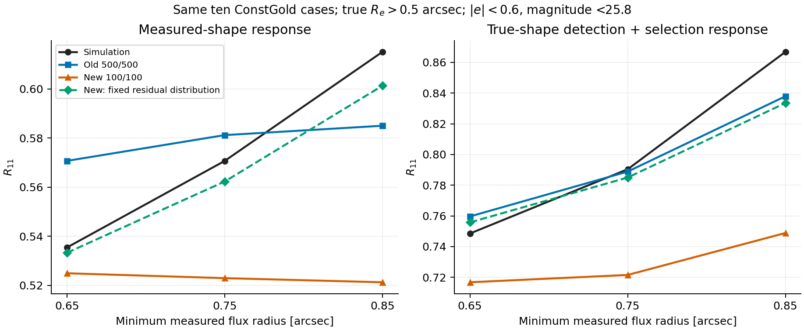

# Old versus new flow: selection-response localization

## Scope and conventions

Read-only diagnostic on 2026-09-05, following the owner's request to localize
the old/new discrepancy before changing training. No training was restarted.
Conventions: [response extraction](CONVENTIONS.md#6-response-estimators),
[model-side selection](CONVENTIONS.md#6e-the-model-must-re-select-not-inherit),
and [multiplicative bias](CONVENTIONS.md#8-m-and-its-relatives--one-sign-convention).
Every response below is R11 from antithetic g1=+/-0.02; m=R_sim/R_model-1.

The new diagnostic uses ten cases chosen before seeing the results:
40, 51, 62, 73, 84, 95, 106, 117, 128, 139. Both models use identical
18<true magnitude<25.8 and 0.5<true Re<1.5 support, complete neighbour scenes,
the transition-aware detector, and fixed R_blend. Measured cuts are
|e|<0.6, MAG_AUTO<25.8, and FLUX_RADIUS>=0.75 arcsec. Each model selects its
own outputs with 64 Sobol draws and common seed 7301 between shear legs.
This ten-case screen is not the full 100-case validation or a training-seed study.

## What was already established on all 100 cases

On the shared Re>0.5 population, measured complete R11 is 0.57962756,
old 500/500 predicts 0.58181954, and new 10/10 predicts 0.50461580.
Thus the expanded small-galaxy evaluation population does not create the failure.
This does not exclude effects of the different training populations.

The true-ellipticity detection-plus-selection test isolates flow selection
probabilities from predicted measured shapes. Its old-model residual is
-0.00123952 +/- 0.00109112, versus new 10/10 -0.09081250 +/- 0.00108468
(paired case-bootstrap SE). The old total is therefore not simply rescued
by an opposing large error in the measured-shape numerator. Individual
selection cuts can still have compensating errors.

## Checkpoint differences

Both checkpoints use the same eight physical conditions: sheared intrinsic
e1/e2, Sersic n, true magnitude, true Re, and near/far/maximum neighbour flux.
Both use four measured outputs (ngmix e1/e2, magnitude, log flux radius),
ten affine coupling blocks, hidden width 256, seed 501, the same two source
catalogues, and a four-million-row combined cap.

The old 500/500 model has a 128-unit mean head. Its residual flow drops both
ellipticity conditions and their missing-value indicators. At fixed other
conditions its shear dependence is therefore a location shift of the full
four-output distribution. The new 100/100 affine flow has no separate head
and sees all conditions, allowing conditional spread and correlations to
change with ellipticity. Its response losses differentiate sampled full-flow
means. A mean head's absolute output is not itself the predicted mean; see
the identifiability note in `sbsi/measurement_model.py:ConditionalMeanFlow`.

Other changes are confounded with architecture: old/new true-Re training
floors 0.5/0.37, weights 500/100, from-scratch versus pure-NLL warm start,
80/30 training epochs, and last-eight/last-five SWA. Both had the row cap;
removing it is not a demonstrated explanation or remedy.

## Exact cut factorial on the ten-case screen

Scheduler array 16324863 completed both models in 6m07s, exit zero.
The diagnostic intercepts the production evaluator's actual draws and
reduces all cuts from them, avoiding independent Monte Carlo differences
between cut arms. It asserts agreement with the production all-cut
denominator/numerator for every case and leg, and measured selected counts.

| Measured cuts | Simulation R11 | Old 500/500 | New 100/100 |
|---|---:|---:|---:|
| None | 0.952594 | 0.971966 | 0.971684 |
| Magnitude | 0.956550 | 0.976372 | 0.975124 |
| Radius | 1.008432 | 1.004470 | 0.959524 |
| Shape | 0.531037 | 0.566100 | 0.524629 |
| Magnitude + radius | 1.010036 | 1.005615 | 0.960540 |
| Shape + magnitude | 0.531835 | 0.567538 | 0.524377 |
| Shape + radius | 0.569520 | 0.580803 | 0.522760 |
| All | 0.570680 | 0.581186 | 0.522964 |

The no-cut model responses differ by only 0.000282. Radius selection alone
raises the simulated response by 0.055838 and the old prediction by 0.032504,
but lowers the new prediction by 0.012160. This is a substantial discrepancy
before any measured-shape cut is applied. Magnitude selection is much smaller.

The old model has compensation between cut errors: its measured-shape
response residual is +0.035063 with shape alone, -0.003962 with radius alone,
and +0.010506 with all cuts. More directly, its true-ellipticity selection
residual is +0.010021 with shape alone, -0.010347 with radius alone, and
-0.001517 with all cuts. These cut effects are not additive independent terms.

The ten-case all-cut m values are old -1.808 +/- 0.686% and new
+9.124 +/- 0.761% (paired case-bootstrap SE). These must not replace the
100-case old-model m=-0.377%; the screen has a different case population.

## Threshold dependence

Holding magnitude and shape cuts fixed:

| Minimum measured radius, arcsec | Simulation R11 | Old | New |
|---|---:|---:|---:|
| 0.65 | 0.535453 | 0.570706 | 0.524954 |
| 0.75 | 0.570680 | 0.581186 | 0.522964 |
| 0.85 | 0.615055 | 0.585000 | 0.521295 |

The new prediction is nearly flat while the simulated response increases.
The old trend is also too weak; its agreement is threshold dependent.
At shape thresholds 0.5/0.6/0.7 with the other cuts fixed, old m is
+2.223/-1.808/-1.256%, versus new +10.050/+9.124/+10.007%.
Thresholds were chosen as diagnostics; none was tuned or adopted for inference.

## Mean-preserving transport test

A second read-only array, 16324912, tests the role of the distribution's
shear dependence beyond its mean. For paired full-output draws y+ and y-,
let mu+ and mu- be their per-object sample means and set

    residual_mid = ((y+ - mu+) + (y- - mu-))/2
    y_location_plus  = residual_mid + mu+
    y_location_minus = residual_mid + mu-

This preserves all four per-object means in both legs, including mean log
radius, and uses the original leg-specific detector weights and truth shapes.
It freezes the paired-midpoint residual distribution between legs. This is
a representation-dependent ablation of the existing CRN transport, not a
trained model, a uniquely identified physical noise trajectory, or an empirical
calibration correction. Per-leg mean preservation is asserted numerically.

Both tasks completed successfully (old 6m31s, new 6m21s), with empty stderr.
All original measured and predicted per-case sufficient statistics reproduced
the first run exactly. The old location-only control changes responses only
at approximately floating-point/hard-boundary sensitivity levels.

| Cuts | Simulation R11 | New original | New fixed residual distribution |
|---|---:|---:|---:|
| None | 0.952594 | 0.971684 | 0.971684 |
| Radius | 1.008432 | 0.959524 | 1.009491 |
| Shape | 0.531037 | 0.524629 | 0.529764 |
| Magnitude + radius | 1.010036 | 0.960540 | 1.010470 |
| All | 0.570680 | 0.522964 | 0.562302 |

The radius-only m improves from **+5.097 +/- 0.412%** to
**-0.105 +/- 0.396%**; all-cut m improves from **+9.124 +/- 0.761%** to
**+1.490 +/- 0.725%**. The all-cut measured-response residual magnitude
falls by about 82%. True-ellipticity detection-plus-selection response moves
from 0.721552 to 0.784992 against simulated 0.790378: its residual magnitude
falls by about 92%, independently of any predicted measured-shape numerator.
Its remaining residual is -0.005386 +/- 0.002888. Total predicted selected
count changes only from 397085 to 397130, while the response changes strongly.
Thus matching the total pass count alone is also insufficient.

The per-draw derivative's variation about its per-object mean is almost zero
for the old flow (RMS for e1/e2/magnitude/log-radius approximately
4.2e-7/4.2e-7/1.9e-5/1.4e-6), but substantial in the new flow
(0.313/0.163/0.0765/0.284). These are diagnostics of the chosen CRN latent
mapping, not estimates of physical per-galaxy noise trajectories.

## Interpretation and next step

This within-model intervention localizes a large part of the new checkpoint's
failure to shear-dependent changes in its centered conditional distribution,
especially those relevant to the radius cut. It preserves the supervised
per-object means, so changing those means is not necessary to remove most
of this particular discrepancy. The old architecture excludes those changes
at fixed non-shape conditions, explaining a concrete advantage of its
restriction in this comparison. Its own threshold-dependent errors and much
worse held-out NLL remain real limitations.

This does not isolate which marginal variance, correlation, or tail derivative
is responsible, nor prove that shear-independent residuals are physically
correct. The location-only construction uses both shear legs and their
finite-draw means; it is a diagnostic, not a deployable trained density.
Residual failures persist, including approximately +5.87% measured-shape m
at |e|<0.7 and a -0.0333 true-shape selection-response residual at a
0.85-arcsec radius threshold. A different training population, initialization,
and objective could affect why the new flow learned its particular transport.

Before another grid/cap training experiment, the focused next diagnostic is
to separate the shape and photometric blocks of the centered transport and
measure the cut-weighted numerator and denominator derivatives in held-out
simulation property bins. A future model should constrain or supervise the
relevant distribution response while retaining the new model's density fit;
refining only the mean-response grid does not directly target the component
identified here. ConstGold remains a diagnostic transfer set, not a source of
fitted correction factors or training targets. No training was launched.

## Artifacts and reproducibility

External root:
`/project/ls-gruen/users/zekang.zhang/sbsi_caches/plain_complete_flow_response_re037_v1/localize_old_new_v1/`.
It contains `diagnose.py`, `run.sh`, production `old500.json`/`new100.json`,
per-case `*_cuts.json`, `summarize.py`, `summary.json`, checkpoint metadata,
and scheduler logs. The location-only test is in `location_transport_v1/`.
The summary bootstraps pooled ratios on identical case resamples (10,000,
seed 20260905), rather than averaging case ratios or dividing a response SE
by a fixed model response. Checkpoint hashes are embedded in each result.

No production evaluator, model, training target, or catalogue was changed.
