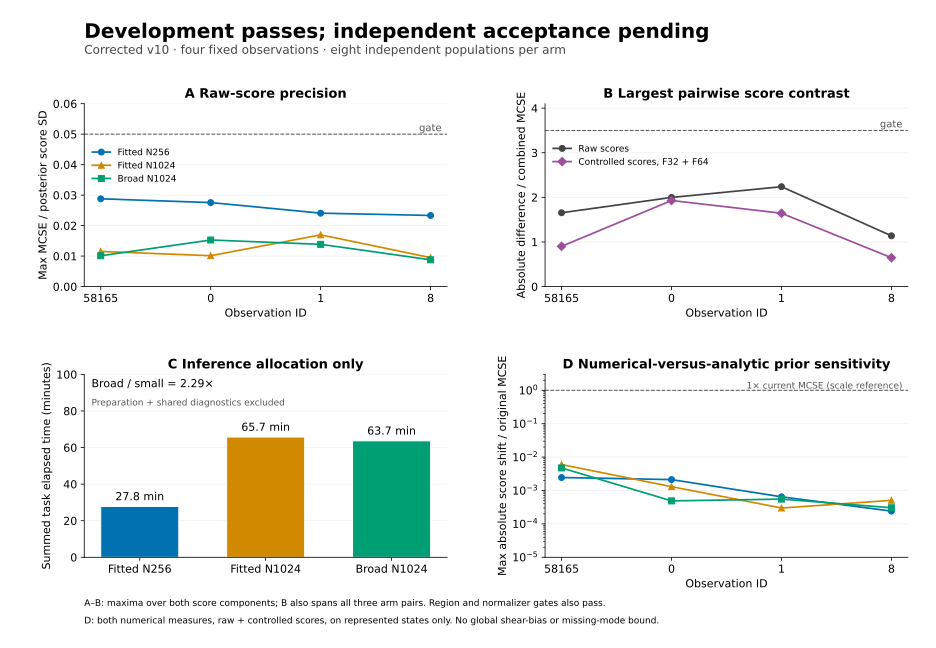

# Autonomous sampler search

## Objective and acceptance boundary

On 2026-10-21 the owner authorized autonomous work until a good and efficient
sampling algorithm is established. The current best validated production
algorithm remains unchanged. The tempered-chain baseline does not pass the
four-object score gate; optional MALA and native exchanges have not solved it.
Development uses observations58165,0,1,8 of the original
`galsbi_pair1m_20261012` reference, with no generating-truth initialization.

The Arbor hypothesis tree is at `doc/sampler_search/.arbor/`. This records
implementation checks separately from scientific acceptance. Passing a unit
test or improving acceptance rate does not give a sampler a passing score.
Search directions and negative results persist across continuations. The
Arbor workflow is defined in
[/home/z/Zekang.Zhang/.agents/skills/arbor/SKILL.md](/home/z/Zekang.Zhang/.agents/skills/arbor/SKILL.md).

Before promotion, a candidate must reproduce posterior score and scene-region
expectations under independent populations, changed initial proposal and
increased particle/mutation effort. It must then pass the held-out gate on
20 new development-excluded observations: four selected uniformly within each
measured magnitude band <21,21–23,23–24,24–25,25–25.8, using seed2026102204,
with the same measured radius and ellipticity cuts. This panel is constructed
without inference results and is not used for tuning. Failure on this panel
rejects promotion; subsequent search requires a fresh held-out panel.

Initial operational precision requirement: all score components have
replicate MCSE <=0.05 times posterior standard deviation (effective sample
count >=400), and changing effort/proposal must change each mean by less than
both3.5 combined MCSE and0.1 posterior standard deviation. Region masses
(target within2 magnitudes of measured flux; target over3 magnitudes fainter)
must agree within3.5 combined MCSE and0.05 absolute mass. These regions are
diagnostics, not asserted complete descriptions of all modes. Normalizer
relative MCSE must be <0.1 and run-weight ESS >=80% of the number of runs.
Use at least8 fresh independent runs for a candidate/reference comparison.
The report-v4 audit additionally requires agreement of the two mean normalizers
within3.5 combined standard errors on the mass scale; see the audit below.
Extinct populations count as zero normalizing mass and are never silently
replaced. Cost comparisons use all initialization, annealing and diagnostics,
with matched accuracy, hardware and preserved numerical batching. These
finite checks support empirical reliability, not a universal convergence
proof or a population shear-calibration claim.

## Current status

No candidate is accepted yet. **Corrected v10 passes the complete development
comparison.** Eight independent populations per arm compare fitted N256/T64/M64,
fitted N1024/T64/M64 and broad Student-t5 N1024/T64/M64, with the same corrected
support, frozen geometry and phase coefficients. All12 precision gates and all
three pairwise raw-score/region/normalizer and both-measure controlled-score
comparisons pass. The largest controlled contrast is1.929 combined MCSE.
Allocated inference totals are1667/3944/3820 seconds: small fitted is2.29 times
cheaper than broad at this stage. Full preparation cost and held-out reliability
are still required. See the [audited complete result](V10_PARTICLE_COMPARISON.md#completed-audited-development-comparison).

This development snapshot shows maxima over the two score components. The
agreement panel also spans all three arm pairs and both numerical measures for
controlled scores. Cost is summed inference allocation only; preparation and
shared diagnostics are excluded. Prior sensitivity concerns represented states.
These are posterior scores for four fixed observations, not shear estimates.
The [vector figure](evidence/sampler_development_20261022.svg) and
[plotted data with provenance](evidence/sampler_development_figure_20261022.json)
are generated directly from the two pinned completed audits.

The fresh twenty-object workflow is now submitted with four Gaussian pilots
per four-observation group, eight paired production populations per arm,
independent fitted geometry/proposals/phase coefficients, unchanged raw gates,
and both F32/F64 controlled-score comparisons. It counts preparation, fitting,
sampling, phase diagnostics, reporting and verification costs. All-inclusive
cost must be lower; no accuracy gate is waived for speed. The
[current launch](CORRECTED_HELDOUT_RUNNER.md#current-launch) is warmup17435348,
paired production17435350 and CPU report17435351, with at most four V100s.
All five preparation groups pass. The first production group completes all
eight independent candidate/reference pairs and 16 phase diagnostics without
extinction; a [metadata review](evidence/heldout_first_group_complete_20261022.json)
verifies the complete first-group receipts. No interim score comparison is used for
tuning. Full scientific results remain pending.

The first launch failed before any pilot because the preflight pinned changing
OS telemetry as immutable input. The repaired declaration records those reads
and generated font inventories separately while preserving scientific caches.
All993 integration tests pass. Both original preflight and failed launch costs
remain charged; source, settings and seeds are unchanged. The
[startup failure](CORRECTED_HELDOUT_RUNNER.md#startup-harness-repair-before-any-science)
is preserved. This is a pre-science orchestration repair, not replacement of a
failed scientific population. The earlier historical v7 production remains
cancelled and its old pilots are not reused.

The candidate combines corrected exchange support, independent-pilot gradient
geometry, a normalized fitted initial proposal with broad tails, and64 fixed
mutations per temperature. These address different failures; neither acceptance
rates, local geometry nor stable incremental particle weights alone established
reliable score expectations. Physical coordinates move jointly in their
correlated block. Separate nuisance/SED/environment/exchange moves permit
appropriate proposal laws and cheaper valid likelihood updates; every block
must preserve the same bridge. The mixture is an implementation choice to be
judged by independent accuracy per total cost, not an assumption of parameter
independence.

## Earlier failures and unresolved scope

V7 passed the original raw gates, but a separately fitted periodic phase control
exposed a4.544-MCSE corrected-g1 disagreement at object0 (measured magnitude22.47).
V9 narrowed that gap at substantially higher cost. The subsequent native
exchange audit found a missing lower-uniform support bound: some allowed
analytic target marks have zero numerical environment density, and the old
swap correction failed to reject them. The common helper now does. Historical
trajectory occurrence and score impact remain unknown; the prepared replay
harness has not been run. See [support evidence](PARTICLE_ENDPOINT_COMPATIBILITY_AUDIT.md#actual-prior-counterexamples-and-practical-limits)
and [v9 comparison](V9_PARTICLE_COMPARISON.md#completed-result-narrower-discrepancy-mixed-precision-and-cost).

The optional informed-environment v8 costs1.713 times its baseline and worsens
normalizer precision on all four objects. Bright controlled-score precision
improves, other results are mixed, and the two historical arms differ in their
support guard. It is not adopted. See [v8 evidence](V8_PARTICLE_COMPARISON.md#completed-result-n16-benefit-remains-unestablished).

The isolated categorical optimization passes full state/decision/RNG GPU replay.
Ordinary exchange blocks improve1.132–1.169 times; relocation is0.993–1.055 times,
including the slower case. Runtime integration is deferred to retain the
scientific source used in corrected development. These are block timings, not
full-sampler efficiency. See [trained-model results](EXCHANGE_CATEGORICAL_RESULTS.md#trained-model-comparison).
A separate four-pair full-run replay and cost experiment is now eligible to
share the same four-GPU node with the held-out work, with one benchmark worker.
The verified node capacity preserves the combined four-GPU ceiling; its original
completion dependency was removed before any benchmark task started. It compares every saved scientific output and
all64 stages while timing complete new processes, conditional on the existing
frozen fits; no speed result yet. See [frozen design and launch](EXCHANGE_FULL_SMC_REPLAY.md#current-status).

Passing fixed-object integration checks would not prove population shear
calibration or explain the catalogue-wide additive residual. The target uses
an analytic target prior and numerical environment law; matching the conditional
likelihood alone does not establish that every mock-generation/inference prior
is the same. F32 controls remain qualified diagnostics; the zero-mean identity
concerns the intended continuous F64 measure. Rare shared modes can evade finite
replication. Production defaults and the catalogue shear estimate are unchanged.

The corrected-development prior audit now evaluates all 73,728 saved target
particles from all 24 populations. Replacing the analytic target prior with the
continuous numerical prior on represented states changes every raw or controlled
score by less than 0.006 of its original MCSE, in both F32 and F64 measures. The
largest relative shift is the bright object's controlled g2 in the large arm:
F64 change -0.012961 with paired MCSE 0.011399. This is small compared with its
original score MCSE of 2.173028. The audited baselines and coordinate/prior
densities replay; no numerical-only type or zero-density state occurs in this
sample. These observations do not bound missing coordinate support, shared
unvisited modes, or catalogue shear bias. The actual sampler target is unchanged.
See [paired prior-sensitivity evidence](CORRECTED_PRIOR_SENSITIVITY.md#result-and-interpretation).

## First direction: fixed annealed particles

The proposal q0 is a normalized mixture of two diagonal Gaussians in the first
nine transformed native target coordinates, times uniform periodic phase.
Its component centres use measured quantities only and span measurement-like
and fainter targets. It has full support; no clipping or rejection changes its
law. The unchanged numerical Poisson generator supplies environments.

The bridge is

`gamma_beta(x,E) = q_environment(E) q0(x)^(1-beta) [p_analytic(x) K(y|x,E)]^beta`.

The fixed temperature schedule is beta_j=(j/T)^2. Weight increments are
`delta_beta * (log p + log K - log q0)`. Initial off-prior-support draws retain
zero mass rather than being discarded from the denominator. Each observation
resamples within its own particle block. Native scene payloads, numerical
likelihood values and ancestry follow resampling and rejection exactly.

The intended mutation construction preserves the current bridge. Historical
v7/v8/v9 exchange implementations omitted a numerical-support bound, as
documented in the current-status erratum above; their results do not by
themselves establish invariant mutation. The corrected physical random walk moves
all five physical coordinates jointly; nuisance and SED steps reuse the
invariant likelihood after replay checks. Environment refreshes/position moves
are reversible for q_environment. Native exchanges use the original
p(type|x) auxiliary draw with the full proposal correction at every beta.
An exact q0 independence move adds its reverse/forward density. Schedule,
proposal scales and mutation order are fixed independently of production
particles. No population-fitted kernel is silently treated as invariant.

The algorithm follows the resample/move construction of
[Del Moral, Doucet and Jasra](https://www.stats.ox.ac.uk/~doucet/delmoral_doucet_jasra_sequentialmontecarlosamplersJRSSB.pdf).
Under its fixed-kernel conditions, the normalizing-constant estimator is
unbiased; log normalizers and finite-particle normalized expectations are not.
Independent populations must therefore be compared and combined on the
normalizer scale. Particle weight ESS and ancestry are diagnostics, not MCMC
ESS or proof that a mode is present. Retaining intermediate mutation states,
as in [waste-free SMC](https://arxiv.org/abs/2011.02328), is a subsequent
efficiency hypothesis only if the basic method first establishes correct
weights at acceptable cost.

## Predeclared experiments

Artifact root:
`/project/ls-gruen/users/zekang.zhang/sbsi/catalogue_prior/sampler_search_20261021`.
Heavy work uses Slurm, with at most4 concurrent GPUs and arrays throttled to2.
The source snapshot and exact launcher will precede each numerical run.

1. Independently test SMC normalization/moments/region mass on correlated
   Gaussian and separated-mixture analytic examples; test q0 density and
   periodicity; test bridge detailed balance including off-support endpoints.
   These are implementation gates, not real-posterior evidence.
2. Trained-model smoke:4 objects,64 particles each,8 stages,8 mutations per
   stage,seed2026102120,g=(0,0). Require finite output, exact state retention,
   unchanged-kernel replay within1e-6 and nuisance-summary replay within1e-10.
3. First development diagnostic:256 particles per object,64 stages,32
   mutations per stage,4 independent seeds2026102130–2026102133. Inspect
   genealogy, normalizer stability, score spread and represented regions.
   Four runs are exploratory and cannot satisfy the eight-run promotion gate.
4. Choose the next experiment from this evidence. Increase particle count or
   mutation effort only to answer a diagnosed question; preserve failed runs,
   retain fixed seeds, and do not call an uncalibrated faster run successful.

## First four-run results

The integrated suite17418421 passed489 tests with1 skip. Smoke17418432
completed with final-state likelihood replay passing. All four Gaussian
runs17418434 and report17418436 completed; the held-out panel was frozen by
job17418433 before development outcomes. Source_v1 remains immutable.

The four-run result **fails** the exploratory precision check. Mean total
cost is99.13 seconds per population (four observations). Bright-object score
means range from−33.70 to76.62 and−56.78 to229.49. Combined score effective
counts from independent-population errors are41.45 and11.35; normalizer
relative MCSE is0.233. The remaining objects have effective counts252/674,
395/1548 and1945/5594. These four-run estimates are uncertain and cannot
satisfy the eight-run acceptance requirement. Final incremental weight ESS
near N did not expose the bright failure. Regions are overwhelmingly
measurement-like, but their true relative weights remain unvalidated.

The optional Student-t comparison (same N256/T64/M32, df5, seeds2026102140–43)
is frozen in source_v2, array17418636, report17418639. It changes q0 and adds
per-stage acceptance diagnostics, preserving the final target. Its27 proposal
unit tests pass, including bitwise replay of the Gaussian default. At the same
scale, t5 component covariance is5/3 times Gaussian covariance; this experiment
compares the complete proposal choice, not tails alone.

A separate hypothesis fits physical covariance from the completed Gaussian
pilots, freezes it, then uses fresh seeds. This tests whether the narrow bright
likelihood needs smaller correlated moves. The geometry is a proposal only;
pilot populations are not reused as production estimates or treated as exact
posterior samples. The held-out panel remains untouched.

The [component review](INFERENCE_COMPONENT_REVIEW.md#what-remains-before-a-calibrated-shear-result)
records the other inference issues; this search does not repair them by
changing posterior targets or adding calibration offsets.

## Subsequent hypothesis: proposal tails

Node n5 prepares an optional Student-t q0 while the Gaussian run stays frozen.
For f=p*K, the incremental-weight second moment under the exact bridge at beta
contains the integral `q0^(1-beta-2*delta) f^(beta+2*delta)`. A final step to1
therefore raises f to2-beta and q0 to beta-1. If a surviving f tail is
exponential and q0 is Gaussian, this idealized second moment diverges. The
Dirichlet ALR factor has exponential tails, but other native support/prior
factors must leave a positive tail region before the statement applies to
this full posterior. This motivates a controlled heavy-tail comparison;
it does not demonstrate infinite variance in the observed runs or guarantee
that a Student-t proposal is efficient.

## Geometry and structural experiments

The Student-t four-run comparison completed without an accuracy gain:
bright effective counts44.29/257.79, normalizer relative MCSE0.293; object0
normalizer relative MCSE0.215. Mean total97.75 seconds. At beta=1 the first
two runs accept only1.06%/2.56% of bright physical proposals versus62–63% for
the faintest object. Tail changes alone did not fix late-stage movement.

Node n6 uses within-run physical covariance pooled equally over the four
Gaussian pilots, with circular phase residuals. Geometry is frozen in
`geometry_v1.json`, SHA256
`4e0ed611e60d393245e1f1ddc5d50abf5a035f8614ae86c6138dc08158ef20a1`.
It preserves positive definiteness, interpolates precision from a broad early
kernel to the pilot estimate, and rejects reused pilot seeds. Correlation may
help even when marginal scales remain broad; the pilot covariance is not a
convergence estimate. CPU fit17418727 and18 geometry tests passed. An initial
stochastic variance test failed at3.16 analytic standard errors; its corrected
five-SE threshold uses the fixed mixture's exact fourth moment, with unchanged
implementation, seed and draw count. Both logs are preserved.

Source_v3 adds this optional geometry and three target-ratio integration tests;
full suite17418779 passed522 tests with3 skips. Predeclared v3 is eight Gaussian
populations N256/T64/M32, seeds2026102150–57, array17418793 throttled to2,
report17418795. Independent pilot preparation cost must be counted in any
end-to-end efficiency comparison; it is not free adaptation.

Node n7 separately prepares a joint native mark exchange and position draw,
with both reverse/forward position densities and changed neighbour-choice
probabilities. Node n8 prepares an independent-pilot likelihood-gradient
metric because broad/mixed pilot covariance may overestimate local scales.
Neither change is used in v3, and neither has numerical efficiency evidence.

## Audit limits

The immutable real-trial sources through v6 abort on extinction and their
reports require completed surviving runs. No actual extinction has occurred.
The new driver now retains per-observation zero normalizing mass explicitly,
lets surviving observations continue, and includes all seeds in the report.
Unknown failures and missing outputs remain errors; they are never zero-mass
receipts. See [extinction semantics](PARTICLE_EXTINCTION.md).

The empirical second-moment audit uses
`(N-1)/N * variance_ddof1 + mean**2`, without an independent-particle correction.
Audited v1–v4 reports preserve raw outputs and alter effective counts by<0.4%,
not score means or replicate MCSE. V5/v6 already use the corrected formula.
Source hashes cover declared files, not all transitive dependencies. Finite
replicate errors can still miss rare, high-weight populations.

## Covariance result and local-gradient trial

All eight v3 covariance runs completed:95.32 seconds mean total, excluding
pilot cost. Bright score effective counts221.67/24.31 and normalizer relative
MCSE0.180 fail; object0 also fails with125.40/60.57. Objects1 and8 pass the
precision component only. No candidate/reference or held-out acceptance.
These are original-report values; audited second moments differ by<0.4%.

The optional joint exchange/relocation passed77 target/proposal tests in
CPU17418889, including accepted/rejected offset retention and beta-dependent
full probability ratios. Its four-run experiment is source_v4, array17418921,
report17418923; same original physical widths and Gaussian q0. The first two
replicas still accept no bright exchange, so moving positions has not yet
shown access to that alternative scene explanation.

Node n8's gradient geometry passed35 tests (17 new) in CPU17418949. GPU
fit17418998 completed from the four immutable v1 pilots. Its artifact
`geometry_gradient_v1.json` SHA256 is
`a2eb847b956a986a94257bf2fce808185813e447dafcc45981f499a7c9d9b2c0`.
The local scale uses the mean physical likelihood-gradient outer product plus
a fixed positive broad precision, inverted and multiplied by2.38²/5. This is
an independent-pilot proposal heuristic; native-prior gradients are omitted,
and neither this metric nor F64 diagnostic gradients replace F32 acceptance.
Bright marginal SDs become[.01822,.01865,.18973,.02597,.01400] in physical
coordinate order(magnitude,log radius,n logit,distortion logit,phase).

The first frozen full-suite job17419013 passed589 tests but failed one model
identity test because source_v5 omitted historical pinned evidence files.
Source_v5a adds those11 unchanged receipts; code, metric and seeds are identical.
The original failed snapshot/log remain. Pending array17419016/report17419026
were cancelled before sampling. Replacement full suite17419085 gates eight
runs17419086, seeds2026102170–77, N256/T64/M32, Gaussian q0 and original exchange.
The corrected independent-population report is included. GPU ceiling remains4,
arrays at2; the gradient fit completed before these populations may start.

Audited re-reports of v1–v4 are job17418948 from immutable report_source_v1.
They preserve original raw runs and reports. Native-support diagnostics are
also being prepared to distinguish impossible exchanges from likelihood
rejections. Node n11 studies an evaluable informed-Poisson initial environment;
it is mathematical preparation, not a new experiment or established solution.

## Gradient-trial startup correction and relocation outcome

Full corrected source_v5a suite17419085 passed590 tests,1 skip. The next
array17419086 failed before Python startup because pytest had changed a cache
file included in its manifest. No population output was produced. Its remaining
pending tasks/report17419125 were cancelled. Source_v5b excludes pytest and
bytecode caches and disables pytest's cache provider in the test launcher;
every retained source/fixture file is byte-identical to the590-test snapshot.
Original failed starts/manifests are retained. Completed prerequisite jobs had
aged out of Slurm's dependency registry, so their successful `sacct` receipts
were verified before direct resubmission17419140. This is the same eight-run
v5 experiment and same seeds, not a retry of a failed scientific population.

All v4 relocating-exchange runs completed. Audited bright effective counts
11.10/97.15 and normalizer relative MCSE0.544 fail; object0 normalizer relative
MCSE0.716 also fails. Mean total114.64seconds versus99.13seconds for v1.
No bright exchanges were accepted. This candidate is rejected as an improvement;
its code remains optional and tested. Native support diagnosis is still pending.
All v1–v4 audited reports completed in17418948 and preserve the original reports.

## Increased-effort reference declaration

The first two gradient-metric v5 runs have final bright physical acceptance
27.9%/30.3%, versus1–3% previously. Their bright means are[-8.95,12.23] and
[-1.91,3.76], but log normalizers3.608/4.455 remain dispersed. These two runs
are evidence of improved movement, not an accuracy or convergence result.

Predeclare v6 before execution: eight seeds2026102180–87,1024 particles per
object,64 stages,64 mutations, Student-t(df5) q0, same frozen gradient geometry.
Source_v5b, target, shear, physical blocks and4096 density batches are unchanged.
This deliberately more expensive reference changes both particle/mutation
effort and the initial proposal. Compare against v5 only after both groups
complete, using the same strict gates. If they disagree, separate these changes
in subsequent diagnostics; do not use the better-looking answer as truth.
The four-object panel is unchanged, and combined GPU concurrency remains4.

## Gradient result and next initial proposal

V5 array17419140/report17419148 completed all eight independent populations.
The frozen gradient metric produces a large improvement in final physical
movement (bright acceptance roughly30% versus1–3% before), at similar cost.
The independent-population precision checks give:

| Observation | Score effective counts | Normalizer relative MCSE | Run-weight ESS /8 | Precision |
|---|---|---|---|---|
|58165|2901.9 /1430.1|0.5034|2.884|fail|
|0|1614.1 /3488.7|0.0917|7.555|pass|
|1|1217.3 /857.7|0.0425|7.900|pass|
|8|811.1 /2374.0|0.0314|7.945|pass|

Mean total97.85seconds excludes the separately recorded metric pilot/fit cost;
it is not an accepted end-to-end efficiency result. The bright normalizer
remains unstable, so n8 has scientific score0 despite useful local movement.

The original v6 launch17419221 landed on A40 hardware. It and its dependent
report17419236 were cancelled before result inspection; partial outputs remain
under `dev_v6_*`. The same declared settings/seeds restart on V100/th-cl-nv02
as17419248, outputs `dev_v6v100_*`, report17419272. The correction is recorded
in `hardware_correction_v6.json`. Only the V100 outputs enter comparison.

Arbor n13 predeclares a normalized pilot-informed q0: retain20% broad original
measurement components, put80% into equally weighted components fitted to the
four independent v1 pilots, including a normalized circular phase law.
Freeze all fit rules, source hashes and artifact before fresh production seeds.
This proposal must not use v5/v6 outcomes to fit its parameters or held-out
objects. The motivating mismatch is concrete: the original q0 redshift centre
is0.7, whereas saved bright posterior medians are approximately0.05–0.07;
uniform phase also ignores a narrow physical direction. The hypothesis is
reduced annealing distance, not a change to the scientific prior. Fit quality
and density correctness alone do not establish better sampling.

## Native exchange support and auxiliary correctness

CPU17419184 replays8192 saved particles from v1/v4, including2048 bright
particles and176186 neighbours. Every numerical environment support mass is1;
all8192 tested bright fixed-swap corrections are finite, ranging−0.0415 to
+0.0380. Native coordinate/prior replay errors are2.84e−14/3.19e−12. Thus a
support hole does not explain fixed-swap rejection on these final states.
At beta1, the remaining log acceptance is the likelihood change plus this
small native correction. The likelihood changes were not replayed here.
Relocation adds a median log proposal penalty of roughly−9.4 to−9.7, explaining
why moving a neighbour toward the centre is not automatically useful.
See `doc/evidence/particle_exchange_support_summary_20261021.json` and its
adjacent reproducible diagnostic script. Early-temperature bridges and other
unseen states are not covered by this diagnostic.

Integrated explicit extinction support (commitfa15521):33 targeted tests and
607 passed/1 skipped in full CPU17419141. The no-extinction path retains its
original RNG and payload semantics. Current v5/v6 remain on source_v5b.
Integrated generic Poisson augmentation (commitbc3a8b):16 tests in17419159,
including toy-scene numerical identities. A real native informed-point density
and singular-support handling are prerequisites; no GPU efficiency claim.
See [proposal mathematics](POISSON_AUGMENTATION_PROPOSAL.md).

## Mean-normalizer comparison audit and v7 declaration

The earlier comparison checked within-group normalizer variation, but omitted
cross-group mean normalizer consistency. Identical posterior score/region
means do not establish that two algorithms recover the same normalizing mass.
Report v4 adds the exact independent mean-mass difference test, with both means
and their standard errors divided by the larger mean for numerical stability.
It requires |difference|<=3.5 combined MCSE. This tightens the acceptance rule;
no earlier failed candidate is rehabilitated or selected by the change.
The old reports remain immutable. New v5/v6 reports use the same v4 reporter.

The same audit checks artifact identity within groups and rejects production
seeds that overlap either group's frozen geometry/proposal pilots. Conditional
on their frozen common pilot artifact, two fresh production groups remain
independent. CPU17419419 passes44 report/diagnostic/extinction tests, including
a factor-two mass error with identical posterior scores that must now fail.
Frozen reporter is `report_source_v2`; v5 report17419420, v6 report17419428.

Before fitting or executing n13, `experiment_v7.json` declares eight fresh
seeds2026102190–97, N256/T64/M32, unchanged gradient geometry/original exchange,
and frozen pilot-informed q0. Hardware is V100/th-cl-nv02, batch4096, two-worker
array within the four-GPU ceiling. Compare against the predeclared v6V100
higher-effort broad-q0 reference after both complete. Count all pilot/fitting
costs separately and in any end-to-end comparison. No held-out observations
are available to this fit. Passing these development checks is prerequisite
to a fresh held-out trial, not promotion by itself.

## Stage-resolved normalizer diagnosis

CPU17419480 audits all four v1 and eight v5 runs plus the single v6V100 run0
already complete at its frozen input cutoff. The original17419416 failed
because v1 predates per-stage acceptance fields; the repaired diagnostic labels
those fields unavailable rather than replacing them by aggregate acceptance.
Original script/failure and exact input scope are retained.

Bright v5 cumulative log-normalizer SD is0.0502 at beta0.0977,0.0367 at0.25,
0.1384 at0.4944, and1.2923 at1. The late window accounts for95.792% of
`Cov(window_increment, final_logZ)/Var(final_logZ)`, a descriptive variance
allocation including cross-window correlations, not a causal attribution.
The disagreement becomes visible late. Mean final physical acceptance is32.3%,
but late joint-independence acceptance is only0.00643% and final acceptance0.
Per-stage weight ESS remains near249/256 while initial-ancestor ESS falls
from15.1 to2.04. Ancestor labels are not reset by accepted independence moves,
so ancestry alone cannot establish dependence on the original coordinates.

The lowest-normalizer run has a much broader physical/phase cloud; between-run
redshift/SED dispersion is comparatively modest. A better q0 changes starts,
intermediate bridge geometry and repeated joint proposals together. It cannot
be described as a test of starting redshift alone. A controlled saved-prefix
late-mutation continuation is a possible follow-up if the fitted proposal does
not stabilize mass. Script and JSON summary are preserved in `doc/evidence/`.

## Fitted proposal implementation and launch

N13 implementatione513b995 adds optional component-conditional von Mises phase
to the normalized Gaussian/Student-t proposal, a frozen four-pilot fitter/loader,
and driver `--initial-proposal`. The default uniform phase path preserves its
original RNG and density arithmetic. Artifact validation checks native target
identity, observations, shear, batches and disjoint pilot seeds. The added
report guards separately check compatibility and cross-group independence.

CPU17419552 passes70 tests including density/circular moments, explicit floor
behavior, bridge Hastings ratios, metadata/seed guards, and the actual driver
with no/some/all extinct observations. CPU fit17419561 supplies
`pilot_initial_proposal_n13_v2.json`, SHA256
`7f11db32019d4e0014a10acc61ea890c17d6fc61b67d0fd9ff36afe3763c46e4`.
A review caught ambiguous Student-t versus Gaussian scale semantics in the
first floor implementation; original artifact/fit17419499 remain preserved and
superseded before any real sampling. V2 follows the first declared formula
`sqrt(3/5)*max(1.5*empirical_SD,0.05*original_coordinate_scale)`.
See [exact fitting rules](PILOT_INITIAL_PROPOSAL.md#predeclared-n13-rule).

Parent source_v7 contains286 manifest files, excludes mutable caches and retains
the pinned V3.9 evidence fixtures. Added runtime Python/NumPy/Torch/GPU/node
metadata for future cost comparisons. Full suite17419607 passes660 tests,1 skip; smoke17419608 completes and
eight V100 populations17419609 are progressing. Report17419615 also depends
on v6 report17419428. Scientific settings/seeds match the declaration.
No fitted-proposal population has passed the scientific gate yet.

## Audit of the actual posterior and nuisance variables

The [bridge audit](PARTICLE_BRIDGE_AUDIT.md#finding), CPU17419483, finds no new
missing conditioning or Jacobian. It confirms the analytic-target/numerical-
environment hybrid prior, which differs slightly from the mock target sampler.
On8192 saved v5 states, correcting that target-prior difference shifts the
bright score by[−0.0414,−0.0559], less than0.009 of existing Monte Carlo errors.
This is a represented-state sensitivity check, not a bound on missed modes or
a correction to calibration. Target-independent environment draws replay
bitwise, and z/SED perturbations preserve likelihood/response inputs to1.42e−14.
A three-dimensional per-type marginal-prior identity is verified algebraically;
no numerical collapsed sampler is implemented.

The audit also permits off-environment-support informed draws to retain zero
weight at the first positive temperature without evaluating their full proposal
density, provided they are neither scored nor mutated first. All valid-state
bridge tilts remain necessary. This corrects an overly restrictive requirement
in the generic augmentation note; no real informed-environment sampler exists
yet. N14 is developing the standalone numerical native intensity needed for it.

## Numerical native measure and throughput preparation

N14 module `numerical_native_intensity.py` supplies the continuous numerical
native mark intensity with absolute type rates and inverse-CDF slopes, shared
conditional factors and generator cuts. It includes interpolation-cap slivers
outside analytic support. CPU17419657 passes29 new and5 existing checks; commit
efd794c is integrated as an unused helper, outside frozen source_v7. Separate
coverage diagnostics expose clamp atoms and finite-table failed-draw mass;
no post-cut renormalization or reinterpretation of generator errors as known
zero-mass populations is allowed. N16 is preparing an optional informed initial
environment using this measure, with full valid-state bridge tilt and retained
off-support zero-weight draws. No such scene proposal is running yet.

A fixed-payload V100 throughput benchmark17419751 waits for v6 resource release.
It duplicates1024 saved v5 rows four times while retaining the4096 density batch,
checks per-row K and complete summary replay, then times complete mutation
blocks at1024/4096 rows. No inference or new observations are generated. Exact
replay is prerequisite; duplicate-state timings can overstate gains for distinct
observations because caches see repeated native values. Its immutable script
and launcher are under `throughput_benchmark_source` in the artifact root.

## Fitted-proposal development result

Arrays17419248 (V100 reference) and17419609 (fitted proposal) completed all
eight declared populations. Reports17419428 and17419615 use the predeclared
v4 normalizer/score/region criteria. Every v7 observation passes precision
and agrees with the higher-effort, independently seeded, broad-q0 reference.
The reference itself passes all precision gates; its comparison with the
older v5 group fails because v5 fails its own bright normalizer precision.

| Observation | v7 score mean | v7 MCSE | v7 normalizer relative MCSE | v7 run-weight ESS/8 |
| --- | --- | --- | --- | --- |
| 58165 | 1.7363, 4.9547 | 4.6116, 4.9461 | 0.027818 | 7.9569 |
| 0 | -0.9966, -8.1725 | 1.1675, 1.2185 | 0.033112 | 7.9391 |
| 1 | -2.4477, -4.3267 | 0.2418, 0.5473 | 0.027750 | 7.9571 |
| 8 | -1.8546, 1.2324 | 0.0689, 0.0367 | 0.012255 | 7.9916 |

The bright reference score is[7.2541,11.7031] with MCSE[1.4846,2.8027]. Its
normalizer relative MCSE is0.080742. Mean total per population is101.4422
seconds for v7 and477.6077 for the reference:4.71 times less production cost
at the declared precision threshold, not equal achieved variance. Scheduler
allocated elapsed time for four pilots, gradient fit, proposal fit and eight
candidate runs sums1404seconds (including the4-second CPU proposal fit).
This full declared development-recipe cost, not101seconds alone, supplies
Arbor's inverse-cost development score. Tests, exploratory failures and
search costs are separate and not amortized into a production speed claim.

Artifacts are `sampler_search_20261021/dev_v7_report.json` and
`dev_v6v100_report_v4.json` under the project catalogue-prior data root. V7
changes starts, the intermediate bridge and repeated joint independence
proposals together. This result cannot attribute the gain solely to starts.
It does not rule out rare modes missed by all finite populations.

## Frozen held-out validation

Declaration `heldout_v7_20261022/declaration.json`, SHA256
`a5900095c91fdbe158ccaa4657e1aa30ad9e1134a042ec857372554891b087a4`,
was written before any held-out inference. Source is an immutable copy of
source_v7 plus the workflow/evaluator and its tests,288 manifest-listed files.
The20 selected objects retain five original groups of four, preserving the
numerical likelihood group size and batch4096. All GPU stages use V100 on
th-cl-nv02; arrays are throttled to two workers.

For each group, four fresh Gaussian N256/T64/M32 pilot populations fit the
unchanged gradient metric and v2 proposal recipe. These are algorithmic
warmup, never production estimates. Candidate: eight N256/T64/M32 populations
with fitted proposal. Reference: eight N1024/T64/M64 populations with broad
Student-t5 proposal and the same independently frozen geometry. The seed
rule is base+10*group+replica, with bases2026102300 (pilot),2026102400
(candidate),2026102500 (reference). All are disjoint from development.

`doc/evidence/run_particle_heldout_20261022.py` records complete subprocess
wall time, hardware and original result receipts. Both recipes are charged
all four pilot runs and gradient fitting; only the candidate pays proposal
fitting. Reporting is charged equally. All20 objects must pass the same
precision, score, region and normalizer comparisons, and the candidate's
full cost must be smaller. No effort extension, object/seed replacement,
threshold change or refitting after results is allowed. Failure rejects
promotion; any subsequent tuning needs a fresh validation panel.

CPU17420215 passes25 evaluator/report tests in6.73seconds, including missing,
duplicate and failed-group rejection and mandatory end-to-end cost improvement.
Warmup17420232 precedes paired production17420233, then CPU report17420234.
Startup and downstream numerical replay must still be checked. The held-out
result has not yet been produced.

## Bounded throughput replay

Read-only benchmark17419751 completed on V100. Duplicating1024 saved states to
4096 with density batches fixed at4096 reproduces K and summaries exactly
(maximum differences0). Per-row throughput improves2.162 times for physical,
1.476 for nuisance,1.409 for environment,1.974 for positions and1.230 for
exchange moves. This is not a16-observation benchmark: repeated-state cache
reuse can overstate gains for distinct observations. It does not authorize
changing numerical likelihood batches, nor enter the held-out speed claim.
Receipt: `sampler_search_20261021/throughput_v100.json`.

## Remaining finite-population bias boundary

The current ratio of sums, sum(Zhat*Sbar)/sum(Zhat), is not an exactly
unbiased posterior expectation at finite replication. Improved normalizer
stability and effort comparisons reduce a visible concern; they do not prove
that residual integration bias vanishes when many galaxy scores are averaged.
This distinction matters for a catalogue-level additive-shear requirement.

A possible later direction is coupled particle independent Metropolis-Hastings.
Treat a complete independently piloted SMC population as a proposal Q, with
extended target proportional to Zhat*Q, and use its particle-average score as
the observable. Whole-population independence acceptance uses the ratio of
normalizer estimates. Coupled chains with an uncapped telescoping correction
can remove initialization bias under appropriate moment and meeting-time
conditions; see [Middleton et al., Algorithm3 and Proposition7](https://proceedings.mlr.press/v89/middleton19a/middleton19a.pdf).

This is not implemented or validated for SBSI. Zero normalizing estimates,
unknown failures, score moments and meeting-time tails require explicit
handling; finite-state empirical replays would test only their finite pool.
No finite-pool reweighting, discarded long meetings or imposed iteration cap
would establish an unbiased SBSI estimator. Current acceptance gates retain
their empirical finite-panel scope.

## Phase control exposes a hidden score disagreement

N15's original diagnostic failed first on F32-only legacy forward wrappers,
then on its predeclared requirement that all three finite-difference steps
(including1e-4) meet1e-4 scaled error. Both failures and source snapshots are
preserved. The independent F64 adapter repaired the wrapper mismatch without
changing sampling code. A separately declared v2 protocol checks steps2e-6,
1e-6,5e-7 against the same threshold, motivated by observed second-order
truncation;32 CPU tests include deliberately wrong derivative rejection.

V2 GPU17420604 completes all28 fixed saved populations in223seconds. Saved
F32 likelihood and saved F64 score replay errors are0; independent F64 forward
error is at most1.78e-15. All fine-step scaled errors are below8.11e-6. Four
v1 pilots alone fit frozen coefficients; all eight v5/v6/v7 populations are
then evaluated. Maximum sampled |logK64-logK32| is9.23e-4, so exact F32/F64
identity is not asserted. Full original normalizer weighting is retained in
both the F32-sampled and explicitly F64-reweighted diagnostics.

The control reduces noise unequally. On observation0, corrected g1 is
0.47868+/-0.18701 (v5),0.40469+/-0.09526 (v6), and1.06998+/-0.11117 (v7).
V7-v6 differs by about4.55 combined MCSE; the raw difference had been below
1.2. F64 reweighting changes any evaluated mean by less than0.000790 of its
raw MCSE. Noise reduction therefore exposes an unresolved accuracy concern.
A correction cannot rescue failed normalizers or establish mode coverage.
See [complete control evidence](PHASE_STEIN_CONTROL.md#v2-real-result-score-noise-reduction-and-remaining-disagreement).

The original held-out declaration is preserved along with
`heldout_v7_20261022/pause_before_production.json`. The panel is not an oracle
for repairing this development failure. New work uses only the original four
objects. V9 preserves the fitted proposal/geometry and usesN1024/T64/M64,
eight fresh seeds, unchanged source_v7 and V100 hardware. Its declaration is
`experiment_v9_higher_effort_fitted.json`, SHA256
`0abb076980d17a262a5652982f776ce58ae1dfd8e29fa70ada4f0a0728ef4f18`.
Raw comparisons with both v6 and v7 and the same frozen phase coefficients
are queued before seeing v9 results. No outcome-driven coefficient refit.

## Informed-environment integration and fresh comparison

Optional n16 implementationf84ba7a retains every original off-support raw
draw and its zero mass, corrects the bridge by the complete scene density
ratio, and updates that ratio for all environment-changing moves. Default
bitwise replay and174 implementation tests pass CPU17420283. Independent
final review17420432 finds density/MH ratio errors below2.15e-14; a tiny
continuous inverse-table support edge now rejects explicitly. Numerical
clamp atoms and unknown representation failures still raise. This is not a
claim of full discrete-RNG measure exactness.

Reporter d98942a fingerprints the entire informed-proposal law and pilot
seeds. Different bridges compare only under the same target-source hashes
and explicit endpoint, with a recorded compatibility mode. Old report
versions remain incompatible. Full isolated suite17420682 passes495 tests,
3 optional skips. The integrated parent snapshot is separately tested.

The fresh baseline/informed comparison usesN256/T64/M32, eight seeds per
arm (2026102600..07 and2026102700..07), same frozen target proposal/geometry,
and one V100 worker. The informed arm uses augmentation probability0.5,
uniform native type/phase, and the declared0.1arcsec central position mixture.
Declaration `experiment_v8_informed_environment.json`, SHA256
`b7b5a991854f9a400f0d2ed9ba22a5d240c90985d760762ba62e9d721b76bfc7`,
predates any real-model run. No historical-report hash bypass or held-out
promotion is used. [Implementation](INFORMED_ENVIRONMENT_PROPOSAL.md) and
[independent review](INFORMED_ENVIRONMENT_REVIEW.md) retain limitations.

The n16 integrated snapshot passes782 tests,1 skipped (CPU17420828,
81.91seconds), including explicit pre-extension default replay. The single
warning is the pre-existing NumPy scalar-conversion deprecation in a test.
Native target support/likelihood and artifact defaults remain unchanged when
the optional environment proposal is absent. Scientific runs remain pending.

## Score localization and diagnostic launch repair

The fixed read-only localization of observation 0 used all particles and
original normalizer weights. CPU 17420950 completed in 5 seconds after
9 focused tests passed (17420920). No single population closes the
0.665288 +/- 0.146402 v7-minus-v6 corrected-g1 gap. Fixed upper 5%
absolute-score tails contribute 53.99% of it; 46.01% remains elsewhere.
About 72% lies within the same dominant phase bin, with little occupancy
change. These overlapping marginal descriptions do not establish a cause.
See [localization evidence](PHASE_SCORE_LOCALIZATION.md#completed-cpu-evidence).

Source_v8 smoke 17420872 completed successfully in 30 seconds, and both
baseline and informed-environment production started. The held-out pilot
preparation 17420232 completed all five groups; its outcomes are not inspected
for tuning and held-out production remains cancelled.

The frozen phase source uses a JSON manifest, whereas the initially prepared
v9 follow-up launcher expected SHA256SUMS. Job 17420835 was cancelled while
pending, before execution. Replacement 17421115 verifies the original manifest
digest and each file digest. Neither frozen source nor scientific settings
changed. Independent v8 phase diagnostics 17421116 depend on all 16 paired
runs. Its timestamped addendum was written after the first baseline task
started but before inspecting v8 scientific outcomes, using the already
frozen v1 coefficients without refitting. It supplements the original raw
gates and cannot override a failure. The separate repair receipt preserves
both launchers and their hashes.

## Independent audit and further efficiency hypotheses

An independent saved-array calculation reproduces the observation 0 phase
discrepancy to numerical precision, including separate F64 reweighting.
Model phase regularity, sign, pairing, original denominators and whole-run
influence covariance were reviewed. [Full audit](PHASE_CONTROL_INDEPENDENT_AUDIT.md#conclusion-for-the-existing-development-comparison)
fixes unsupported deterministic thinning and misleading F32 expectation
metadata for future diagnostics. All evaluated old runs retained every
particle; the fixes do not explain their difference. Original queued phase
snapshots and reports are preserved with the documented metadata erratum.

Cycle 6 adds two bounded hypotheses while the frozen development arrays run:

- n19: for r squared=e1 squared+e2 squared, set
  F=(1+r squared)/(r squared+0.01), a=(-F e2,F e1), and
  C=a*T+derivative_phase(a). The fixed analytic candidate score is S-C,
  with epsilon=0.1 and no fitting or recentering. The derivative term is
  essential; omitting it changes the expectation. CPU validation and all-state
  development comparisons must precede any efficiency conclusion.
- n20: retain invariant mutation paths instead of discarding their intermediate
  states, following [waste-free SMC](https://arxiv.org/html/2011.02328v2).
  The isolated prototype must verify the normalizer/weighted-moment identities
  and compare accuracy at counted density-evaluation cost on known targets.
  Correlated path points are never independent precision replicates. Real scene
  integration, fixed numerical batching and mode coverage remain separate gates.

The tree's advisory depth and sibling limits are now 4; its 16-cycle budget,
resource ceiling and scientific requirements are unchanged. Neither hypothesis
is an accepted improvement. Endpoint compatibility of current v8/v9 snapshots
is receiving a separate explicit audit before cross-version interpretation.

A bounded mutation profiler (17421460, after phase 17421115) reuses the original
read-only throughput benchmark and saved v5 states. It records each physical,
nuisance, environment, position and exchange call separately at 1024/4096 rows,
including explicit device synchronization. Source and input hashes, kernel
replay and retained-state fingerprints remain mandatory. Profiles include
instrumentation overhead and cache effects; only later uninstrumented replay
can establish a speedup. Four-observation groups and 4096-row density shape
remain unchanged.

## Analytic-control development outcome

The n19 fixed formula passed 12 correctness tests (17421399); read-only CPU
17421436 processed 28 saved populations in 10 seconds. It reduces estimated
MCSE in 18/24 evaluation components versus raw and 13/24 versus the constant
control, but consistently worsens the faint object's g2 uncertainty. Its
observation 0 g1 means are 0.39301 (v5), 0.47179 (v6), and 0.84211 (v7);
the last two differ by 0.37032 +/- 0.10477, still 3.534 combined MCSE.
[Full evidence](ANALYTIC_PHASE_CONTROL.md#saved-state-result-mixed-variance-benefit-discrepancy-remains)
records every component and both measures. The implementation is retained as
a standalone diagnostic; it is not adopted as a general score replacement
and does not remove the unresolved sampling concern.

## Waste-free matched-cost result

The n20 isolated prototype passes its correctness checks, including exact
unnormalized expectations with extinction. Its predeclared CPU experiment
(17421484) uses 128 independent populations per arm/target and exactly 13,560
density rows per population. Waste-free/standard primary variance is 1.089
for the Gaussian and 2.755 for the separated mixture, with CPU time 15–16%
higher. The mixture mode-mass variance increases 3.408-fold. This recipe is
rejected without further tuning; active scene sampling is unchanged.
[Full result](WASTE_FREE_SMC_RESULTS.md#matched-cost-evidence) records intervals,
all observables, source identity and the separate limitations of real batching.

V8's scheduling throttle increased from one to two while v9 finishes, within
the four-GPU total and the existing dependency graph. The timestamped external
`v8_resource_addendum_20261022.json` records unchanged scientific settings
and the runtime-concurrency caveat. This is an operational allocation change,
not a result-driven alteration of either comparison arm.
